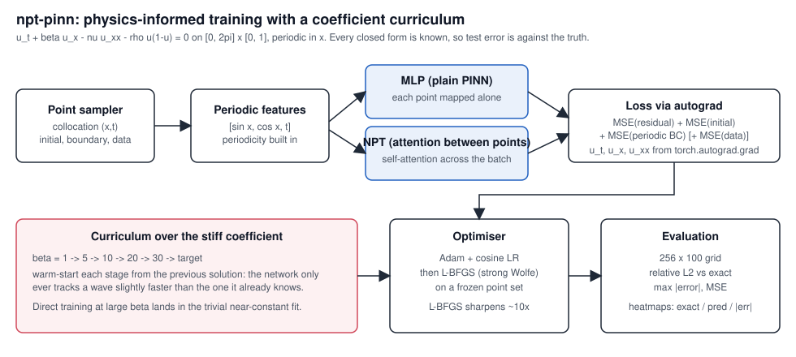
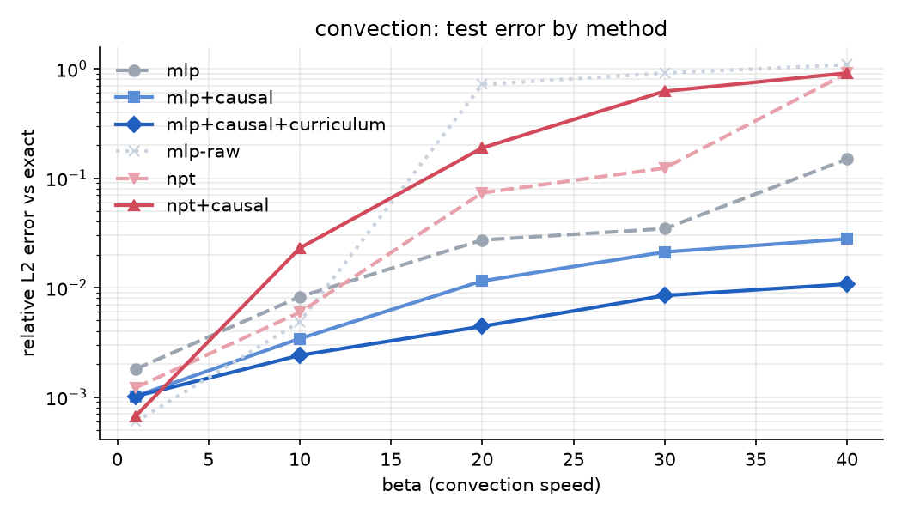
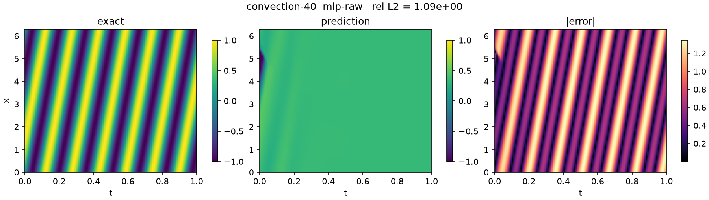
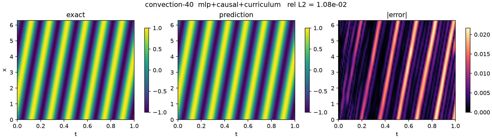
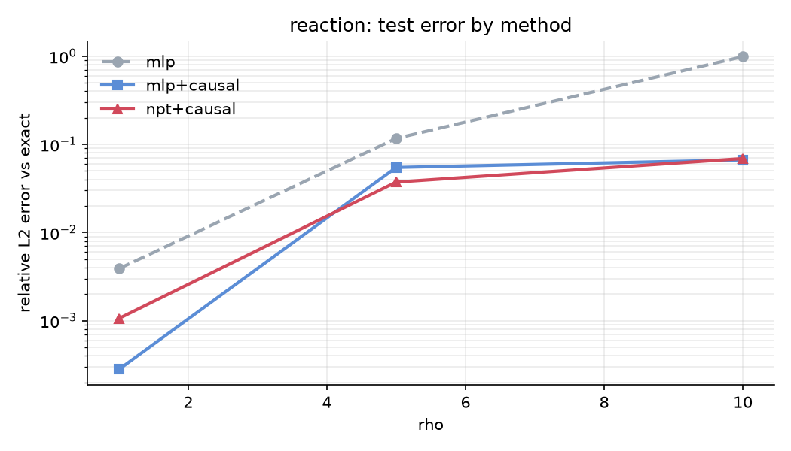
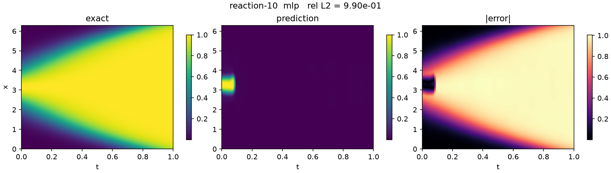
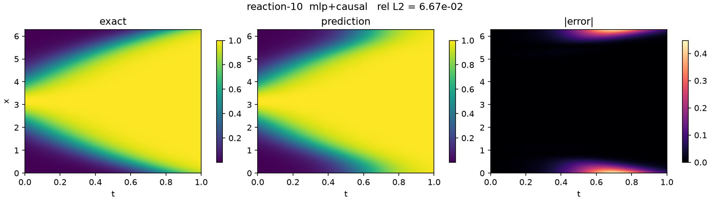

# PI-NPT: physics-informed MLP and attention-between-datapoints surrogates, scored against exact solutions

Physics-informed training of two neural surrogates for u(x, t) on

    u_t + beta*u_x - nu*u_xx - rho*u*(1-u) = 0,   x in [0, 2pi], t in [0, 1], periodic in x

- `mlp`: the standard PINN, each point mapped independently.
- `npt`: *attention between datapoints* (the non-parametric-transformer idea): the batch of
  collocation points is embedded, self-attention mixes across it, and each point reads out
  u by cross-attending into that context.

Pure convection, diffusion and reaction each have a closed-form solution, so **every number
below is the relative L2 error of the trained model against the exact solution on a
256 x 100 grid**, never against another solver. The hard regime is convection at large
beta, where the solution is a fast-travelling wave and a plain PINN collapses to a trivial
fit. This repo reproduces that collapse and then removes it.



## Results

All runs: CPU (Apple laptop, 4 threads), seed 0, 8000 Adam steps + 300 L-BFGS, 2048
collocation points for the MLP and 512 for the NPT (attention is quadratic). 39 runs,
95 minutes total. Full rows (losses, config, seconds, parameter counts) in
[`results/results.json`](results/results.json); heatmaps for every run in `results/`.

### Convection, u(x,0) = sin x, exact u = sin(x − βt)

| β | mlp-raw (textbook PINN) | mlp | mlp+causal | **mlp+causal+curriculum** | npt | npt+causal |
|---|---|---|---|---|---|---|
| 1  | 5.9e-4 | 1.8e-3 | 1.0e-3 | 1.0e-3 | 1.2e-3 | **6.7e-4** |
| 10 | 4.9e-3 | 8.3e-3 | 3.4e-3 | **2.4e-3** | 5.9e-3 | 2.3e-2 |
| 20 | 0.72 | 2.7e-2 | 1.2e-2 | **4.4e-3** | 7.4e-2 | 0.19 |
| 30 | 0.91 | 3.5e-2 | 2.1e-2 | **8.5e-3** | 0.12 | 0.62 |
| 40 | 1.09 | 0.15 | 2.8e-2 | **1.1e-2** | 0.91 | 0.92 |



**What the table says.**

1. **The collapse is real.** The textbook PINN (`mlp-raw`: raw `(x, t)` input, soft initial
   condition, unweighted residual) is excellent at β ≤ 10 and useless from β = 20 on
   (0.72 → 1.09: it predicts something no closer than zero).
2. **Most of the fix is representational.** A convection wave at speed β oscillates β/2π
   times along t; a tanh network fed raw t cannot express that within a practical budget.
   Adding harmonics `sin/cos(2πkt), k ≤ 8` to the input (`mlp`) alone takes β = 30 from
   0.91 to 3.5e-2. Their first-layer weights start damped (×0.1) so slow solutions are not
   fit through frequencies they do not have; without that, β = 1 degrades to 0.58.
3. **Hard initial condition + causal weighting + curriculum finish it.** `u = u₀(x) + t·N`
   makes the initial condition exact; weighting the residual at time t by
   `exp(−ε · loss at earlier t)` builds the solution forward from t = 0; warm-starting up the
   ladder β = 1 → 10 → 20 → 30 → 40 keeps each step small. Together: **1.1e-2 at β = 40,
   two orders of magnitude under the baseline**, and monotone in β.
4. **Attention between datapoints: a mixed, honest result.** The NPT is the best model at
   β = 1 (6.7e-4) and competitive at β = 10, but under this budget it does not beat the MLP
   at high β. Two confounds remain: it attends over 512 points against the MLP's 2048, and
   the NPT was not run with the curriculum. Both are the first items in
   [`docs/SAGEMAKER_HANDOFF.md`](docs/SAGEMAKER_HANDOFF.md).

| β = 40, textbook PINN (rel L2 1.09) | β = 40, mlp+causal+curriculum (rel L2 1.1e-2) |
|---|---|
|  |  |

*Exact / prediction / absolute error. The baseline has not found the wave at all; the full
recipe tracks every crest with error concentrated in a thin band along the characteristics.*

### Reaction, u(x,0) = Gaussian bump, exact u = u₀eᵖᵗ / (u₀eᵖᵗ + 1 − u₀)

| ρ | mlp | mlp+causal | npt+causal |
|---|---|---|---|
| 1  | 3.9e-3 | **2.8e-4** | 1.1e-3 |
| 5  | 0.12 | 5.5e-2 | **3.7e-2** |
| 10 | 0.99 | **6.7e-2** | 6.9e-2 |



The plain PINN collapses at ρ = 10 (0.99); the causal recipe brings it to 6.7e-2. The NPT
is the best model at ρ = 5. The logistic front sharpens as ρ grows, so a second domain
confirms the same picture: the failure is the optimisation path, not the architecture.

| ρ = 10, mlp (0.99) | ρ = 10, mlp+causal (6.7e-2) |
|---|---|
|  |  |

## How it works

**Problem** (`pde.py`). `Problem(kind, beta|nu|rho)` holds the coefficient, the initial
condition, the exact solution and the autograd residual. The exact forms are checked
against the PDE in the tests, so the scoring target is known-correct.

**Inputs** (`models.py`). Both models take `[sin x, cos x, t, sin 2πkt, cos 2πkt]`. The x
pair makes periodicity exact by construction, so there is no boundary loss term.

**NPT** (`models.py`). The context stream is built from *detached* inputs and a point's
own `(x, t)` enters only through its cross-attention query. That keeps the input Jacobian
diagonal, `∂u_i/∂x_j = 0 for i ≠ j`, so the vector-Jacobian products the residual uses are
the per-point partials and not column sums contaminated by other points. (A straightforward
set-transformer violates this and trains on a wrong operator; the test
`test_npt_input_jacobian_is_diagonal` pins it.) Attention runs under the math SDPA kernel
because the residual needs double backward through it.

**Training** (`train.py`). One forward over the concatenated point set per step with the
collocation points as context. `Solution(hard_initial=True)` enforces `u(x,0) = u₀(x)`
exactly. Causal weighting bins collocation points by t, weights bin m by
`exp(−ε Σ_{m'<m} L_{m'})` (detached), and steps ε up `1e-2 → 1e-1 → 1 → 10 → 100` each time
every weight exceeds 0.99. Adam with cosine decay, then L-BFGS (strong Wolfe) on a fixed
point set and the unweighted residual. `fit_curriculum` warm-starts up the sorted ladder of
requested coefficients.

**Evaluation** (`evaluate.py`). The 25,600-point grid is shuffled and predicted in chunks of
`context_size` (the training set size) so the NPT sees the kind of set it was trained on
and the full grid never has to fit through attention at once.

## Install

```bash
git clone https://github.com/devanshugupta/PI-NPT.git && cd PI-NPT
python -m venv .venv && source .venv/bin/activate
pip install -e ".[dev]"      # torch, numpy, matplotlib, pytest
pytest tests -q              # 11 tests, ~4 s
```

## Run

```bash
# the convection table above (~70 min CPU; MLP rows ~1 min each, NPT rows ~4-5 min)
python -m nptpinn.experiments --kind convection --coeffs 1 10 20 30 40

# the reaction table (~20 min)
python -m nptpinn.experiments --kind reaction --coeffs 1 5 10 --methods mlp mlp+causal npt+causal

# one cell, or a smoke run
python -m nptpinn.experiments --kind convection --coeffs 30 --methods mlp+causal+curriculum
python -m nptpinn.experiments --quick            # ~2 min, writes to results/quick
```

Method names are an architecture plus flags: `mlp`, `npt`, or `mlp-raw` / `npt-raw` (raw t,
no harmonics); `+causal` adds the hard initial condition and causal weighting;
`+curriculum` warm-starts up the ladder of requested coefficients. Rows already in
`results.json` are skipped, so runs resume and extend.

Each run writes `results.json`, `error_vs_<coeff>.png`, and one
`<problem>_<method>.png` heatmap (exact / prediction / |error|).

```python
from nptpinn import MLP, Solution, Problem, TrainConfig, fit, errors
p = Problem("convection", beta=30.0)
sol = Solution(MLP(), p.initial, hard_initial=True)
fit(sol, p, TrainConfig(causal=True))
errors(sol, p, chunk=2048)["rel_l2"]
```

## Layout

```
nptpinn/
  pde.py          Problem (exact solutions, residual), grid, sampling
  models.py       MLP, NPT (diagonal input Jacobian), Solution (hard initial condition)
  train.py        TrainConfig, fit (Adam + L-BFGS, causal weighting), fit_curriculum
  evaluate.py     chunked shuffled prediction; rel L2 / max|err| / MSE vs exact
  report.py       error-vs-coefficient plot, heatmaps
  experiments.py  the grid runner (resumable)
tests/            exact forms, Jacobian diagonality, periodicity, hard IC, curriculum path,
                  chunking, orientation, short fits
docs/             architecture.svg, results/, SAGEMAKER_HANDOFF.md
results/          results.json + every heatmap from the runs above
```

## Notes

- Timing: one row (`mlp+causal`, β = 30) took 981 s against ~50 s for its neighbours; the
  L-BFGS line search ran long on that instance. It is reported as measured.
- Ideas this builds on: non-parametric transformers (Kossen et al., 2021), the convection /
  reaction failure-mode benchmark and coefficient curriculum (Krishnapriyan et al., 2021),
  and causal training with Fourier input features (Wang, Sankaran, Wang, Perdikaris, 2023).
  The implementation here is from scratch and tests each ingredient in isolation.
- This replaces the earlier experiments in this repository, which patched a physics loss
  into the full OATML NPT codebase and did not produce usable results.

MIT. Devanshu Gupta.
